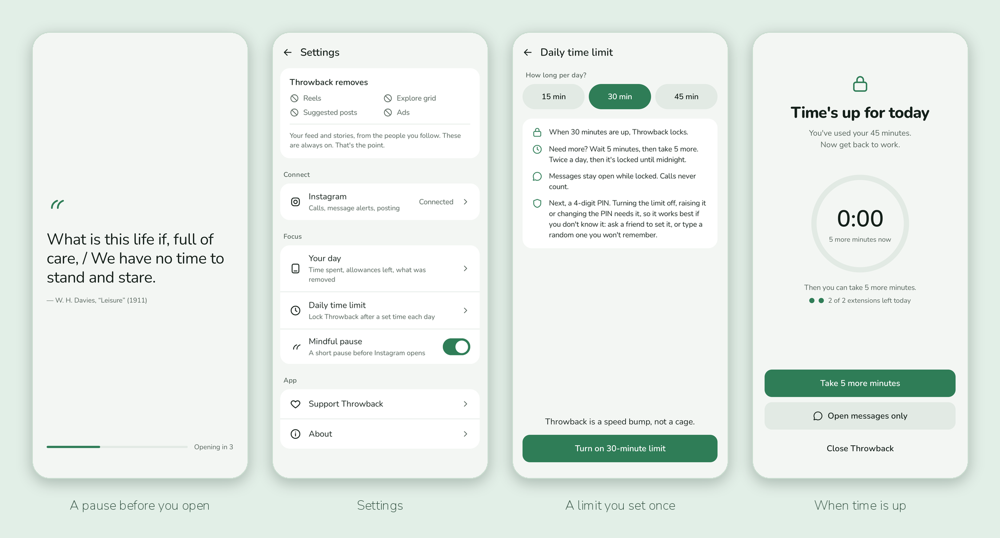
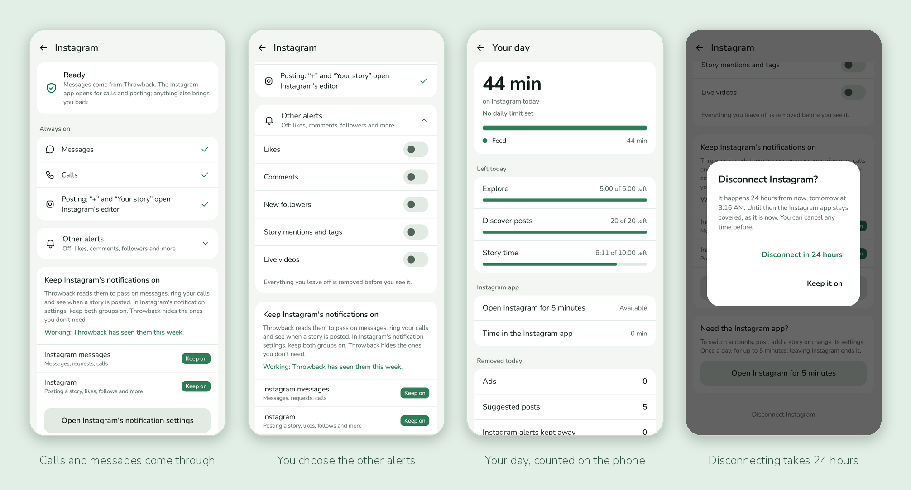

# Throwback: 2019 Mode

Instagram, the way it used to be: just the people you follow, with their stories. No Reels, no Explore
grid, no suggested posts, no ads. When you've seen it all, you're done.

## Why I made it
I don't exactly remember how long I've been struggling with doomscrolling. It's probably been years. Some days, I'd find myself scrolling through Instagram for hours, watching pointless reels, videos, and even AI slop. It got to the point where I'd pick up my phone to get some work done, only to end up scrolling again. At the end, there was no joy or satisfaction, only regrets and a pile of unfinished work.

Things got even worse when I started working from home.

I thought taking a break would help, so I'd deactivate my Instagram account for months at a time. But every time I came back, I'd be doomscrolling again within days. The cycle continued. I even considered leaving Instagram for good, but as wanted to keep up with my friends it was no solution.

Then I tried a few mobile apps (supposed to solve the problem), but they were missing quite a lot of features and were all paid. I felt something like this should be free.I believe everyone should have access to tools that help them take control of their screen time, without having to pay.

So, I decided to build my own: **Throwback: 2019 Mode**.&#x20;

I've tried to make it as complete as possible, but there might be a few bugs or things I've missed. If you try it out, I'd love to hear your feedback. Feel free to suggest features, report bugs, open an
[issue](https://github.com/amitpant7/throwback/issues), or even open a pull request.

I hope it helps you as well.



More screens: [Your day](docs/assets/your-day.png) ·
[Connect Instagram](docs/assets/connect-instagram.png) · [Support](docs/assets/support.png)

## Features

- Your home feed, stories and messages, with the distractions removed (always on, no toggles)
- A little discovery: now and then a suggested post, tagged "Discover", strictly rationed
- The Explore grid for 5 minutes a day, then "Enough for today"
- Reels sent to you in chats play, but swiping on to more reels is stopped after a few swipes
- Optional daily limit of 15, 30 or 45 minutes with a PIN (best set by a friend, or a random one you'll forget), two 5-minute extensions a day, and a messages-only mode when locked
- Optional connected Instagram app: calls, message alerts, and posting with Instagram's own editor; the app stays installed
  but out of reach. Calls ring and are answered there (a chat's call button starts one there);
  messages open in Throwback; other Instagram notifications are removed unless you switch them on
  (security and login alerts always come through)
- A mindful pause before opening (on by default; can be turned off)

## The optional Instagram connection

Instagram sends message alerts and calls only to its own app. If you want them, connect the Instagram
app (Settings → Connect → Instagram): it stays installed for calls and alerts, and Throwback keeps it
out of reach the rest of the time. This needs three special permissions. They are the kind of
permissions digital-wellbeing apps use, and Throwback uses each one only for the Instagram app:

| Permission | What Throwback does with it | What it doesn't do |
|---|---|---|
| Notification access | Passes on Instagram's messages and calls, removes the Instagram alerts you didn't switch on, and notices when a story is posting | Android hands it every app's notifications; Throwback ignores all but Instagram's. It keeps only daily counts, never what a message said |
| Usage access | Notices when the Instagram app comes to the front, so it can cover it outside calls and short passes | Stores or sends nothing about which apps you use |
| Display over other apps | Shows the "Use Throwback instead" cover over the Instagram app | Nothing else |

It never uses the camera, microphone, contacts or location. Disconnecting takes 24 hours, so it can't
be a way round your own limits. The code that uses these permissions is in
[`connect/relay`](app/src/main/java/app/throwback/connect/relay) and
[`connect/guard`](app/src/main/java/app/throwback/connect/guard).



## Your data

**Throwback collects nothing.** No account, no analytics, no ads, no server of its own.

- **What leaves your phone:** only Instagram's own traffic, exactly as in a browser, and once a day a
  download of the public filter rules from this repository (GitHub sees an ordinary download, nothing
  about you).
- **Your Instagram login** happens on Instagram's own page. Throwback never sees or stores your password.
- **What stays on your phone:** your settings, the daily limit with a salted hash of its PIN (never the
  PIN itself), and Your day's counts. Android's own backup keeps only the time-limit settings.
- **Nothing is shared or sold**, because there is nothing to share.

Uninstall Throwback, or clear its storage, and everything it kept is gone. The full
[privacy policy](PRIVACY.md) lists every service involved.

## Download

Free, and not yet on Google Play. Get the APK from the
[latest release](https://github.com/amitpant7/throwback/releases/latest) and open it on your phone
(Android 8 or newer). Not affiliated with Instagram or Meta.

If you connect the Instagram app (calls, message alerts), Android 13 and newer holds back some permissions
from apps installed outside Google Play. Open Settings → Apps → Throwback, tap the **⋮** menu at the
top right, choose **Allow restricted settings**, then grant notification access.

## Opening Throwback's settings

There's no Throwback button on the feed, so it looks exactly like Instagram. Open Throwback's settings
(Connect → Instagram, Your day, time limit, mindful pause, Support, About) any of these ways:

1. **Your profile:** the Throwback icon at the top right (where the Threads icon was).
2. **Instagram's settings:** profile → gear → the **Throwback** section, right after "Your account".
3. **Long-press the Home tab** in the bottom bar.
4. **Long-press the Throwback app icon** on your home screen → **Throwback settings**.

The first time the feed shows, a one-time hint points at the Home long-press.

## Repository layout

A standard single-module Android project: all source code is under `app/src/`.

| Path | What's there |
|---|---|
| `app/src/main/java/app/throwback/` | The app (Kotlin, Jetpack Compose). The entry point (`MainActivity`, `AppRoot`) sits in the root folder, with one folder per area: `ui` (Settings and its screens, onboarding), `connect` (the optional Instagram app connection: relay, guard, passes), `web` (the Instagram WebView, filter rules, page bridge), `timelimit` (daily limit, PIN, lock screens), `core` (shared types, theme, UI kit). [Architecture](docs/ARCHITECTURE.md) shows how they fit |
| `app/src/main/pagescript/` | The page script injected into instagram.com (JavaScript, one file per area; the build joins them). Its [README](app/src/main/pagescript/README.md) lists the files |
| `app/src/main/res/`, `app/src/main/assets/` | Resources and the page's CSS |
| `app/src/test/` | Unit tests (JVM) |
| `app/src/debug/` | Test-build helpers (fake notifications for the emulator) |
| `filters/rules.json` | The filter rules: bundled into the app and fetched daily from this repository |
| `tools/` | Development tools: DevTools scripts, emulator helpers, the page-script lint, the shortcut-icon generator ([README](tools/README.md)) |
| `docs/` | [Architecture](docs/ARCHITECTURE.md) and [handoff notes](docs/HANDOFF.md); [DECISIONS.md](DECISIONS.md) records the product decisions, [PRIVACY.md](PRIVACY.md) the privacy policy; `docs/assets/` has the screenshots |
| `design/` | Logo masters |

## Building

JDK 17 and Android SDK 36 (Android Studio bundles both), then:

```bash
./gradlew assembleDebug testDebugUnitTest lintDebug
tools/pagescript-lint.sh        # after changing the page script (needs Node)
tools/sort-kotlin-imports.py    # Kotlin import order (--fix sorts)
```

The debug APK is `app/build/outputs/apk/debug/app-debug.apk`. More in
[docs/ARCHITECTURE.md](docs/ARCHITECTURE.md).

## Support

Throwback is free, with nothing locked. Settings → Support Throwback → "Support me" opens the
[support page](https://amitpant.com.np/throwback/support/) on the website; support there helps keep
the filters working as Instagram changes. (In-app tips through Google Play are built but switched
off: Google Play can't pay out to Nepal. See `throwback.playTips` in `gradle.properties` and
DECISIONS.md #4e.)

## Licence

[PolyForm Strict 1.0.0](LICENSE): you may read the code and use it for personal, non-commercial purposes; you may not redistribute it or publish changed versions. The APK on the releases page is for your own phone. The Nunito font is under the SIL Open Font License
([docs/fonts-OFL.txt](docs/fonts-OFL.txt)).
