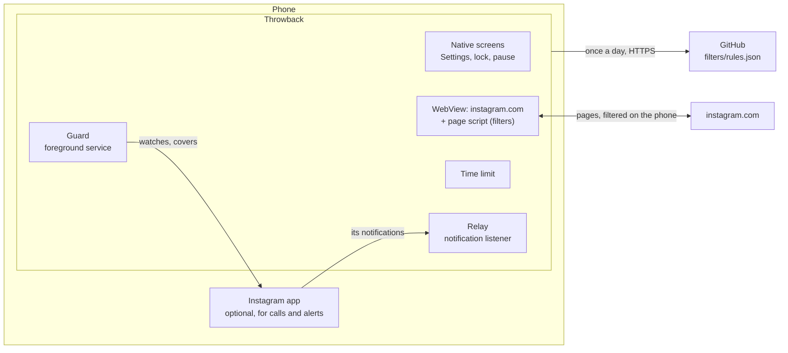
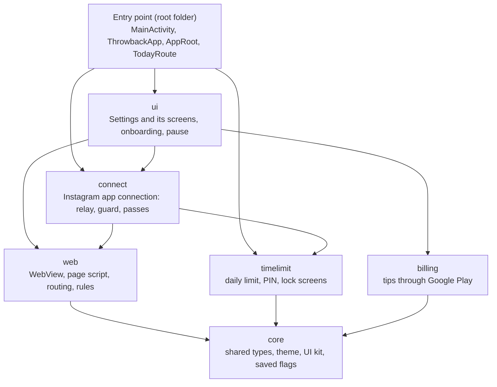

# Throwback architecture

Throwback is one Android app (Kotlin, Jetpack Compose, minSdk 26, targetSdk 36, a single Gradle
module). Instagram itself is instagram.com in one long-lived WebView, with Throwback's filters
injected as JavaScript and CSS. Everything around it is native: onboarding, Settings, the daily
time limit and its lock screens, the mindful pause, "Your day", Make It Yours, Support and About.
The optional Instagram app connection (Settings › Connect › Instagram) adds a notification
listener (the *relay*) and a foreground service (the *guard*).

Product decisions and their reasons are in [DECISIONS.md](../DECISIONS.md); the repository layout is
in the [README](../README.md#repository-layout).

## The system at a glance



- **Nothing leaves the phone** except Instagram's own traffic and the daily rules download (no
  server, account or analytics).
- **The filters run inside the page.** The rules say what to hide and block; when Instagram changes
  its page, a new `filters/rules.json` in this repository fixes every installed app within a day,
  with no app update.
- **The Instagram app is optional.** Instagram sends push notifications only to its own app, so for
  message alerts and calls that app stays installed. Throwback relays its notifications and covers
  it whenever it's opened outside a call or a pass.

## Code layers

`app/src/main/java/app/throwback/`, one folder per area. Arrows mean "uses"; dependencies go one
way only, so each layer can be understood (and tested) without the ones above it.



Every layer also uses `core`; the entry point uses all of them.

| Folder | What it holds |
|---|---|
| (root) | `ThrowbackApp` (process start, warm-up, the app-wide time limit), `MainActivity` (entry point; links, notification taps and shortcuts arrive here), `AppRoot` (what is on screen, and how the areas connect), `TodayRoute` ("Your day" data) |
| `core` | Types shared by the areas (`Contracts`: `WebMode`, `LockState`), `OpenThrowback` (every intent that opens the main screen), `findActivity`, `Supporter` (whether the user has tipped), `RateAsk`, `SupportAsk`, `StartTrace` |
| `core/prefs` | `AppPrefs`: small saved flags (DataStore `ui_prefs`) |
| `core/theme`, `core/ui` | The Sage theme; the shared UI kit (top bar, scaffold, buttons, rows, cards, duration texts, touch blocker) |
| `web` | The WebView (`InstagramScreen`, `InstagramWebController`, `PageConfigSync`), injection (`PageScript`, `ScriptInjector`), routing (`UrlRouter`, `UrlParts`), the page bridge (`BridgeMessage`), page features and clock, renderer crashes |
| `web/rules` | Filter rules: model (`FilterRules`), validation (`RulesValidator`, `RulePatterns`, `PressLabels`, `NotificationRules`), the daily fetch (`RulesFetcher`, `RulesRepository`) |
| `timelimit/engine` | The time-limit engine, pure Kotlin: state machine, trusted clock, PIN hashing |
| `timelimit`, `timelimit/data` | `TimeLimitController` (the engine wired to storage and a ticker), `TimeLimitModule`, the Android clock, `ServerTimeHint`, storage (DataStore `timelimit`) |
| `timelimit/ui` | Setup, manage, PIN entry, lock screens, forgot PIN, the time-left chip |
| `connect` | What the relay, the guard and the screens share: `MessagesFeature` (starts or stops the guard), `Permissions`, `CallInApp` (opens the Instagram app for a call, a post, a story or its settings), `PassLedger` and `GuardPass` (passes), `CallState` |
| `connect/relay` | `RelayListenerService` and the notification logic (`NotificationClassifier`, `RelayRouting`, `RelayNotifier`, `RelayStats`) |
| `connect/guard` | `GuardService`, its pure policy (`GuardPolicy`, `CallScreens`, `PassRules`), the cover (`GuardOverlay`), `GuardHeartbeat`, restart after boot |
| `billing` | Tips through Google Play Billing, parked (DECISIONS.md #4e): the pure rules (`TipRules`, `TipProduct`) stay in `main`; the client `Tips` and Support's tip rows (`ui/about/SupportTips.kt`) are in `app/src/playTips`, built only with `throwback.playTips=true`. The default build uses `app/src/webTips` (Support links to the website) and has no billing library |
| `ui/*` | `settings` (navigation), `connect` (Connect › Instagram setup and settings), `today`, `about` (About, Support), `shortcut` (Make It Yours), `onboarding`, `pause`, `reels` (the reel poster) |

The page script is in `app/src/main/pagescript/`, one file per area; its
[README](../app/src/main/pagescript/README.md) lists the files and the rules for editing them.

**Rules for new code**

- A folder may use only the folders below it in the picture. Inside one area (for example `connect`
  and `connect/relay`) files may use each other.
- Screens that need something from a higher layer get it passed in: Settings receives the
  time-limit screens and "Your day" from `AppRoot` as composable parameters.
- To open Throwback's main screen, use `OpenThrowback.intent(...)`, not `MainActivity` directly.
- Pure decisions (time-limit engine, routing, guard policy, notification sorting) stay free of
  Android types, so they run as JVM unit tests.

**Names that must not change.** Android stores some things under a class or file name, and a
rename silently loses them for every user:

| Name | Why |
|---|---|
| `app.throwback.MainActivity` | The launcher icon and every pinned home-screen shortcut (Make It Yours) point at it |
| `connect.relay.RelayListenerService` | Notification access is granted to this class; renaming it means every user must allow it again (the setup then shows the permission as off and the guard says it's off) |
| DataStore `timelimit`, SharedPreferences `supporter` | Named in the Auto Backup rules (`res/xml/backup_rules.xml`, `data_extraction_rules.xml`) |
| Intent actions in `OpenThrowback` | `ACTION_OPEN_SETTINGS` is also in `res/xml/shortcuts.xml` |

## How things happen

### Opening the app

1. `ThrowbackApp.onCreate` starts reading saved flags and the filter rules in the background,
   creates the time limit (it loads its saved state), and lets `MessagesFeature` start the guard if
   the Instagram app is connected.
2. `MainActivity` shows the splash and hands over to `AppRoot`. Links from other apps, notification
   taps and shortcuts arrive as intents here, at start or later (`onNewIntent`).
3. `AppRoot`: saved flags still loading, the splash stays; onboarding not done, `OnboardingFlow`;
   otherwise `MainScreen`, which starts the WebView at once.
4. `ScriptInjector` registers the page script, built by `PageScript` with the rules and the current
   settings, to run before Instagram's own code on every Instagram page.
5. The page script filters the page and sends `ready` once the first filtered page is drawn; only
   then is the WebView shown, so unfiltered Instagram never appears.

### What's on screen

`MainScreen` works out the one layer on top (`Layer`): Settings, the mindful pause, the lock screen,
the reel poster, or the "Instagram app found" prompt. Only that layer takes Back (Android gives Back
to the handler added last, and a layer can appear under another: the lock engaging while Settings is
open); while any layer shows, the page counts as covered (media paused, no screen reader) and
full-screen layers block touches. A tapped notification or a link from another app closes Settings, so
its page shows.

### Browsing (each navigation)

`UrlRouter` (pure, tested) decides for every navigation: load it, redirect it (blocked pages such
as Reels go to the feed), open it outside Throwback (only after a user's tap), or ignore it. The page
script applies the same path rules to Instagram's in-page navigation. Details under
[Web layer](#web-layer).

### The daily time limit

1. `AppRoot` tells `TimeLimitController` when Instagram is really in use: the activity is resumed
   and neither Settings nor the mindful pause covers the page. Messages-only mode doesn't count.
2. The controller ticks while in use and feeds `TimeLimitEngine`, which keeps the day's usage on a
   trusted clock (changing the phone's time doesn't help) and saves it.
3. At the limit the state becomes `Locked` and the lock screen shows: wait 5 minutes, then the PIN
   gives 5 more minutes, twice a day; after that, locked until the next day. "Open messages only"
   switches the WebView to inbox and chats.
4. With the Instagram app connected, time spent in that app while the guard was stopped is added
   when Throwback next runs (`GuardHeartbeat`).

### A message arrives (Instagram app connected)

1. The Instagram app posts its notification; Android hands it to `RelayListenerService`.
2. `NotificationClassifier` sorts it (call, message, like, comment...); `RelayRouting` decides: calls
   are left alone, messages are replaced by Throwback's own notification, the rest follow the user's
   switches or are removed (and counted for "Your day").
3. `RelayNotifier` posts Throwback's notification; its tap intent comes from `OpenThrowback`
   (`ACTION_OPEN_MESSAGES` plus the chat's link).
4. The tap reaches `MainActivity.onNewIntent`: Settings closes, the page loads the chat, and if the
   limit is locked `AppRoot` switches to messages-only mode first.

### The guard (Instagram app connected)

1. `GuardService` watches which app is in front (usage access) while the screen is on.
2. When the Instagram app comes to the front, `GuardPolicy` decides whether it may stay: during an
   Instagram call (only its call screens), or while a pass runs (only that pass's screens).
3. Otherwise it covers the app (`GuardOverlay`, display over other apps) and brings Throwback to the
   front.
4. During an Instagram call, the rest of Instagram is covered too; a call minimised to its chat
   leaves the user in Throwback, where a "Back to your Instagram call" bar (`CallReturn`) opens the
   call screen again through Instagram's call notification.
5. If a permission it needs is turned off, it stops and says so in a notification; the tap opens
   Settings, where Connect › Instagram shows which permission.

### A pass (Instagram app connected)

The chat's call button, "+" (posting), "Your story", "Open settings in the Instagram app" and "Open
Instagram for 5 minutes" go through `CallInApp`: it checks the limits in `PassLedger` (how often
per hour or day, not while locked), sets `GuardPass` (what is allowed, for how long), and opens the
Instagram app. The guard ends the pass early once the user has been in the app and left it.

### Rules update

Once a day `RulesRepository` downloads `filters/rules.json` from this repository. It is used only if
it is valid and newer than the one in use; otherwise the last good copy (or the bundled one) stays.

## Web layer

**Injection.** The build joins the page script parts into the asset `inject/throwback.js`
(`join<Variant>PageScript`) and copies `filters/rules.json` into the assets (`bundle<Variant>FilterRules`,
which fails the build on invalid JSON). `PageScript.build` puts the config into the script:
`{mode, css, rules, clock, createInApp, storyInApp, supportAsk}`; `ScriptInjector` registers it as a
document-start script for Instagram's origins (or injects it on page start on old WebViews). A config
with only some keys updates the live page through `window.__throwback.configure(...)`.

**Routing.** URLs with a backslash or control characters are refused: Chromium reads their host
differently from any parser. Instagram hosts written with a trailing dot, port or user info go to
the plain address. Opening outside Throwback needs a user's tap; a server redirect counts as one only
when its chain began with one (`ChainGesture`). Facebook/Meta pages load only as login pages
(`hosts.loginPaths`) during a login; Accounts Center in messages-only mode only on the way through a
login. `file:`, `content:`, `data:`, `blob:` and `javascript:` never load. A backstop in
`doUpdateVisitedHistory` routes pages the router never saw (form posts, back/forward). Instagram's
short links (ig.me, instagr.am) stay in Throwback (ig.me/m/<user> goes to the profile). Deep links are
loaded as URLs rebuilt from their checked parts.

**Rules.** `filters/rules.json` is bundled and fetched once a day from this repository
(`RULES_URL`, HTTPS, 512 KB cap, ETag). A fetched file is used only if it validates and is newer.
Validation pins the hosts to Instagram's, accepts only regex patterns that behave the same in
Java and JavaScript and can't backtrack catastrophically (`RulePatterns`, also by syntax), checks that
messages-only still refuses the feed and full mode still blocks Reels, and lets the page press only
dismiss buttons in dialogs and Like/Save in the Explore player (`PressLabels`).

**Page → app** (`BridgeMessage`, JSON `{"t": …}` through `addWebMessageListener`, Instagram origins
and the main frame only; old WebViews use a JavaScript interface that refuses the pass-granting types):

| `t` | App side |
|---|---|
| `ready` | First filtered page drawn: reveal the WebView, send the clock and features |
| `loc` | Location changed (also re-sends "covered" on a new document) |
| `blocked` | Show the short notice for that kind |
| `touch`, `bg` | Pull-to-refresh at the top; page background for the system bars |
| `settings` | Open Throwback's settings (profile icon, settings-page section, Home long-press) |
| `callInApp` | The chat's call button: open the chat in the Instagram app with a call pass |
| `createInApp`, `storyWeb` | "+" / "Your story" with the Instagram app connected (or why the story route waits) |
| `settingsInApp` | "Open settings in the Instagram app" |
| `reelLimit` | Show the reel poster |
| `caughtUp` | "You're all caught up" was seen (rating ask, once) |
| `supportAskShown`, `supportThanks` | The support line was seen / "Say thanks" tapped (opens Support) |
| `share` | Share a reel link from the Explore reel player |
| `serverTime` | The Date of Instagram's own response, for the trusted clock on phones without network time (`ServerTimeHint`) |

**App → page** (`window.__throwback`): `configure(cfg)`, `setCovered(bool)` (pauses media, stops the
page's clocks), and for "Your day" and DevTools `dayStats()`, `perf()`, `feedStats()`, `storyStats()`,
`clockInfo()`, `errors()` (the last page-script steps that threw; each step of a pass runs on its own).

**Page config upkeep** (`PageConfigSync`): installing the script with the current rules (encoded once
per rules object), mode, features and clock, and keeping the live page up to date; nothing is rebuilt
while the app is in the background.

**Features and clock.** `PageFeatures` is one `StateFlow` (Instagram app connected, story route
ready, support ask due); the web host pushes changes while the activity is started. `PageClock` gives
the page the time limit's trusted clock (`offset`, `zoneMin`, `day`, `nextAt`, and `at`, the phone
time when read), only once the time limit's state has loaded, again whenever the app comes to the
front and when the phone's time or zone changes. The page anchors it on a monotonic clock and
ignores clocks older than 10 minutes.

**Renderer crashes** (`RendererCrashes`): the WebView is recreated on the same page; a second crash
within 60 s restarts at home; a third shows the error screen.

## Time limit

`timelimit/engine` is pure Kotlin and fully unit-tested: the limit, the 5-minute wait, PIN extensions
(twice a day), locked until the day ends, changes that take effect the next day, the 3-day forgot-PIN
reset, and the trusted clock. Trusted time comes from the phone's since-boot clock plus the last
trusted time, preferring network time: Android's own (API 33+), else Instagram's server time from the
Date of its responses (the page sends it, `serverTime`; `ServerTimeHint`). After a reboot it is the
earlier of the phone's clock and the last trusted time plus the time since boot, never before the
last trusted time. A new day needs at least 23 hours of real time; the time zone counts from the next
midnight. `TimeLimitController` wires the engine to DataStore (`timelimit`, included in Auto Backup)
and a ticker while Instagram is in front. Its state is unknown (`null`) until loaded: callers that
decide something (the guard, passes) wait for it rather than assume "no limit".

## Instagram app connection (`connect`)

Nothing runs until the setup is finished. `MessagesFeature` starts or stops the guard to match the
setup and the permissions. Notification access is checked for Throwback's listener class itself
(`Permissions`), since Android keeps it under the class name.

- **Relay** (`RelayListenerService`): only Instagram's packages. Calls are never touched; messages and
  missed calls are replaced by Throwback's own notification (opens the chat, messages-only when
  locked); likes, comments, follows, mentions and live follow the user's switches; the rest is
  removed (counted for "Your day", `RelayStats`). `NotificationClassifier` uses Android's call signals
  first, then the rules' channel table; no rule can turn a message into something removed, and an
  unrecognised ongoing notification is kept but counts as a call only with call audio or a call
  screen. Notifications are handled strictly in order (calls first, on their own queue); only this
  profile's (a work-profile or cloned Instagram is left alone).
- **Guard** (`GuardService`, special-use foreground service): watches usage events while the screen
  is on and covers Instagram (`GuardOverlay`) unless a call or a pass allows it. Only the app in
  front counts (the last activity resumed, until it pauses); split screen and floating windows aren't
  followed (#34aa). The cover stays while Instagram is in front. The guard writes a heartbeat; when it was stopped, the Instagram app's time since then is
  added to the day's usage when Throwback next runs (call screens excepted). Call audio counts as
  Instagram's after an Instagram call notification, while one of its call screens shows, or when an
  internet call starts while Instagram is in front (never a phone call on its own, `CallAudioLink`).
  "Disconnect Instagram" takes effect by itself 24 hours after it was asked for (#27b; the PIN too
  while a daily limit is on), on the trusted clock. During a call only
  Instagram's call screens (`appCall.screens`) may be active, once one has been seen in that call
  (`CallScreens`); until then all of Instagram is allowed, so a renamed call screen never cuts a call.
- **Passes** (`PassLedger` on the trusted clock; `CallInApp` opens the app): call button (15 s, 15 taps
  an hour), "Open Instagram for 5 minutes" (once a day, not while locked), posting (Instagram's create
  screens, 20 minutes, 10 a day, not while locked), Instagram's settings (its settings screens,
  10 minutes, 5 a day, not while locked), story (a story budget, #34cc: each pass is 5 minutes in
  Instagram, charged when it ends: 2 minutes if Instagram's posting notification shows, also up to
  90 s after leaving, else the exact time spent; 10 minutes of budget, then 30 minutes locked, when
  "Your story" uses the website's upload; not while the daily limit is reached). The open story pass
  is saved in the ledger, so it is charged exactly once however it ends (#34gg). Time in the app
  during any pass except the call button's counts toward the daily limit (#34ff). Screen patterns
  that fail or are missing allow nothing beyond a 3-second grace.
- Pure rules (`GuardPolicy`, `RelayRouting`, the classifier) are unit-tested; test builds can post
  fake notifications and watch another app (`RelayDebug`, `app/src/debug/`).

## Storage

| Where | What |
|---|---|
| DataStore `timelimit` | Time-limit state: limit, PIN hash and salt, usage, extensions, pending changes (**Auto Backup**) |
| SharedPreferences `supporter` | Whether the user has tipped (builds with Google Play tips, #4e); there it unlocks Make It Yours (**Auto Backup**; Google Play also remembers the tips, and the app asks it at start). Without tips Make It Yours is free and this stays unset |
| DataStore `ui_prefs` | Onboarding, pause, setup done, notification switches, hints (`AppPrefs`) |
| DataStore `web` | Rules ETag and last check (the downloaded rules themselves: `files/filters/rules.json`) |
| SharedPreferences `guard_passes`, `guard_heartbeat`, `relay_stats`, `rate_ask`, `support_ask`, `pause_lines` | Pass ledger, the guard's last beat, relay day counts, rating ask, support ask, the pause's line rotation |
| instagram.com `localStorage` (the page) | `__tb_day` (Your day), `__tb_explore`, `__tb_discover`, `__tb_reels`, `__tb_totals` (support line), `__tb_lastday` (the page's day), `__tb_code_assets` (warm-up); in `sessionStorage`: `__tb_redirects` (loop guard) |

The Instagram login and all WebView data are never backed up. A running pass (`GuardPass`) is kept
in memory only: if Android stops Throwback during one, the pass ends and the guard covers the app
again (it fails closed).

## Known limits and trade-offs

These are deliberate; DECISIONS.md has the reasons.

- **A speed bump, not a cage.** "Clear data" or uninstalling resets everything except what Auto
  Backup restores; revoking a permission stops the guard (it says so). Onboarding says this plainly.
- **Other browsers are out of scope.** instagram.com in Chrome or another browser isn't limited;
  blocking it would need an accessibility service or a VPN, which Throwback doesn't use.
- **Rules are trusted from this repository** over HTTPS, unsigned. A bad rules file can't read data,
  press other buttons or unblock pages the validator protects, but it could weaken filters, so the
  GitHub account needs two-factor login.
- **The guard reacts within about a second**, and needs its permanent notification; some phone
  brands also need battery optimisation turned off for it.
- **Only this profile's Instagram app** is covered (not a work-profile, cloned or Private Space copy).

## Build and tests

```bash
export JAVA_HOME=$(ls -d ~/.local/opt/jdk-17* | head -1)   # or Android Studio's JDK 17
export ANDROID_HOME=~/Android/Sdk
./gradlew assembleDebug testDebugUnitTest lintDebug
tools/pagescript-lint.sh
tools/sort-kotlin-imports.py      # import order (ktlint's), until ktlint is adopted
```

Unit tests (`app/src/test`, same folders as the code) cover the pure parts: the time-limit engine and
controller, rules parsing and validation, routing, the bridge, the guard policy and passes, the
relay, formatters. The WebView and the page script are checked on an emulator or a phone with the
scripts in [tools/](../tools/README.md) (DevTools access, memory and CPU profiles, a stuck-page
catcher).
